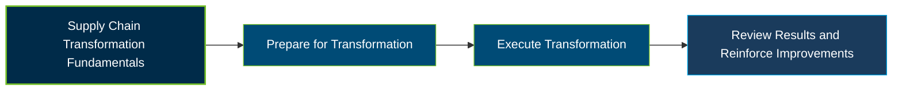

# APICS CTSC Certification Exam Guide

A dedicated study guide and knowledge reference for professionals preparing for the **APICS Certified in Transformation for Supply Chain (CTSC) Certification Exam**, covering the frameworks, strategies, and practices used to lead end-to-end supply chain transformation.

---

## Exam Overview

The APICS CTSC certification validates the knowledge and skills required to plan, execute, and review supply chain transformation initiatives, including organizational change, risk management, and operational improvement.

- **Exam Format**: Computer-based examination at Pearson VUE test centers or online through OnVUE.
- **Target Audience**: Supply chain professionals involved in transformation projects, strategy development, digital capabilities, and organizational improvement.
- **Prerequisites**: No formal eligibility requirement to purchase and take the CTSC exam.

---

## Core Exam Domains & Knowledge Areas

### 1. Supply Chain Transformation Overview

- Supply chain transformation concepts, maturity stages, and strategic drivers.
- Organizational value propositions, frameworks, benchmarking, and operating models.
- Organizational design, leadership responsibilities, risk management, and supply chain security.

### 2. Preparing for Supply Chain Transformation

- Identify transformation drivers and assess the current supply chain state.
- Develop a future-state supply chain operating model and identify performance gaps.
- Establish transformation initiatives, workstreams, projects, and preliminary business cases.

### 3. Executing Supply Chain Transformation

- Develop and adopt change management plans.
- Design and implement supply chain transformation workstreams and projects.
- Establish transformation governance, responsibilities, and risk management frameworks.

### 4. Review of Supply Chain Transformation

- Assess transformation outcomes against objectives and expected performance.
- Evaluate results, identify lessons learned, and communicate findings.
- Reinforce successful improvements and identify opportunities for continued transformation.

---

## Certification Path

---

## Recommended Practice & Study Resources

Use official ASCM materials as the foundation for CTSC exam preparation, supported by focused practice and practical application.

- **CertsGate**: Explore [APICS CTSC certification preparation resources](https://certsgate.com/exams/apics/ctsc) for supplementary study materials and practice to reinforce supply chain transformation knowledge.
- **Practical Study Resources**: Apply the [ASCM SCOR Digital Standard](https://www.ascm.org/learning-development/standards-tools/scor-ds/), Enterprise Standards for Sustainability, and Digital Capabilities Model concepts to practical supply chain transformation scenarios.
